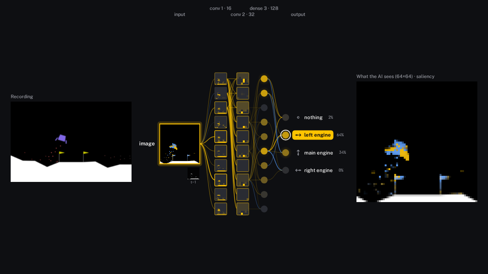
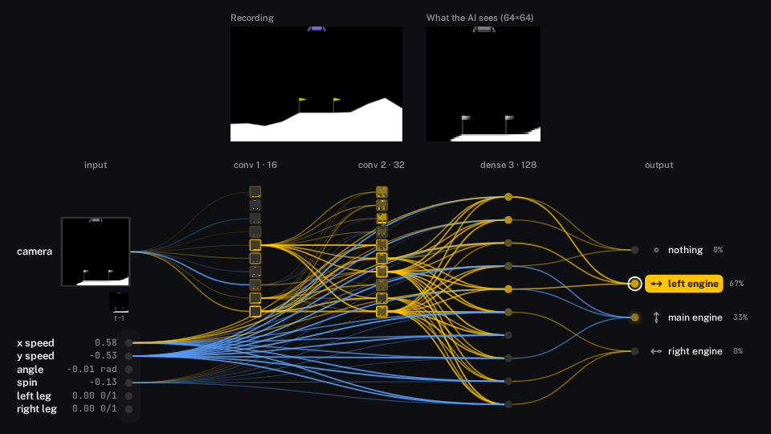
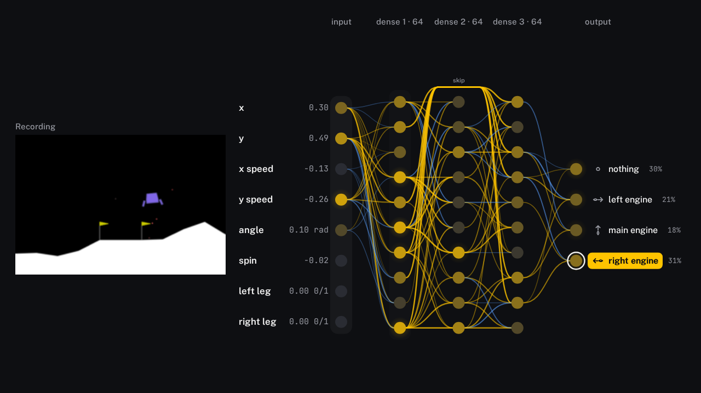
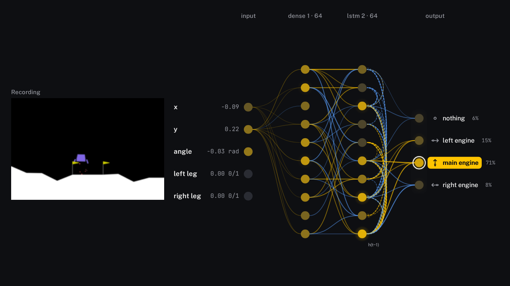

# netglow

Drop in a neural network and a recording of its inputs, and get an animated "glowing network" video of its
**real** activations, tick by tick. Everything runs in your browser tab: the model, the recording and the
video never leave your machine.

**Try it: [ahuou.github.io/netglow](https://ahuou.github.io/netglow/)** (demos: [MLP](https://ahuou.github.io/netglow/?demo=lunar-mlp),
[CNN](https://ahuou.github.io/netglow/?demo=lunar-cnn), [pixels + numbers](https://ahuou.github.io/netglow/?demo=lunar-mixed), [residual MLP](https://ahuou.github.io/netglow/?demo=lunar-resmlp), [LSTM](https://ahuou.github.io/netglow/?demo=lunar-lstm)).


- **Inputs** on the left: label, live value; node colour = how fast that input is changing.
- **Hidden layers** as columns: brightness = activation, normalised per layer over the whole recording, so
  flicker is real change and not noise.
- **Outputs** on the right with your icons: glow = probability, the chosen (argmax) action ringed and lit.
- **Edges**: per node, the top-k strongest contributions this tick (warm = excites, cool = inhibits).
- **Match check**: the model is re-run on the recorded inputs and compared against the actions or outputs you
  logged, so you know the picture shows the network that actually flew the episode.
- **Export** GIF, MP4, WebM, or WebM with alpha to composite over your own footage.

### Image models


- The input column is one **image node**: the current tick's frame, nearest-neighbour upscaled so the
  pixels stay visible, its border lit by how much the frame changed since the last tick. Older frames of a
  stack sit under it (`t−1`, `t−2`, ...). Its edges into the first conv column are the per-channel
  contributions summed over the stack.
- **What the AI sees (W×H)**: a large view of the model's actual input, above the network or beside it
  (View → "What the AI sees"). With "Recording on canvas" on, the recording's own render sits next to it.
  Both are drawn on the canvas, so they are in every export, alpha included (the pictures are opaque, the
  rest stays transparent).
- **Feature maps on conv channels** (toggle): each shown conv channel is drawn as its live activation map
  (the real tensor, after the layer's nonlinearity / pooling), scaled per channel by its 1st to 99th
  percentile over the whole recording. The outline is lit by the channel's mean, as for a plain node.
- **Pixel values** are detected and undone for display: uint8 is shown as 0 to 255; floats in 0..1 or -1..1
  are mapped accordingly; anything else (mean/std normalised) is stretched per channel to its 1st..99th
  percentile. **Channels**: a channel count divisible by 3 is read as RGB frames, otherwise grayscale
  frames. **Newest frame**: last channels by default (first for stacks stored newest first). All three can
  be overridden in the View panel, which also says what was detected.

### Saliency heatmap



- Pictures → **Saliency heatmap**: gradient × input of the chosen output (the argmax; for "Values" outputs the
  largest |output|), per pixel, summed over the channels of the frame stack, drawn over "What the AI sees" and
  the image node. Warm = pushes the chosen output up, cool = down (the edge colours), alpha grows with the size.
  **Heatmap opacity** sets its strength. It is part of every export.
- The gradient is **exact**: onnxruntime-web has no autograd, so netglow runs its own reverse pass over the nodes
  on the image path (`Conv`, `Gemm`, `MatMul`, ReLU / tanh / sigmoid masks from the real activations, max-pool
  winners, average pools, batch norm, `Cast` / scaling, residual `Add`, `Concat` into a mixed head), at every
  tick's real activations. `test/saliency.mjs` checks it against central finite differences in onnxruntime.
- Colour scale: the 99th percentile of |grad × input| over the whole recording, so brightness is comparable
  across ticks. Not available for recurrent models or ops outside that list (the View panel says so).

### Mixed inputs: an image and plain numbers



- Models with several ONNX inputs, e.g. `frames` `[N, C, H, W]` and `vector` `[N, D]`, each running through its
  own branch (a conv stack, dense layers, or nothing at all) and joined by one `Concat` before the dense head.
- Each branch gets its own lane: the image input is the image node with its "What the AI sees" view and live
  feature maps on the conv branch; the numbers are labelled, draggable input rows like an MLP's. Both lanes feed
  the merged dense column with their real activations.
- Attribution stays exact at the join: the dense layer's weight columns are split per branch, so a number's edge
  is `W[j, i] · x[i]` and a conv channel's edge is `Σ_pixels W[j, c, p] · a[c, p]`, read from the real `Concat`
  output. Edges into one column share one scale, so the two branches are drawn on a common footing.
- Demo **LunarLander, pixels + numbers** (`?demo=lunar-mixed`): 64×64 frames plus x / y speed, angle, spin and
  leg contacts. It landed 50 of 50 fresh seeds (mean return 276); with the velocities handed over as numbers the
  task is much easier than flying from pixels alone (the CNN demo landed 11 of 20 eval seeds).

### Skip connections



- ResNet-style blocks, `Add(block(x), x)` with an identity skip or `Add(block(x), P(x))` with one projection layer
  (`Gemm`, `MatMul` or a `Conv`, e.g. 1×1 stride 2), in dense MLPs and in conv stacks, also inside one branch of a
  multi-input model.
- The main path stays a row of columns; the skip is drawn as a rail **over the block** from the block's input
  column into the column after it, labelled `skip` or `projection`.
- Attribution at the `Add` is split exactly between its two addends: the block's last layer contributes
  `W[j, i] · a[i]` as usual, the identity skip contributes `x[j]` to unit `j` (a conv map: its channel mean),
  a projection `P[j, i] · x[i]`. Both edge sets into a column share one scale.
- A column that feeds both the next layer and a skip picks its shown units from both consumers.
- Demo **LunarLander, residual MLP** (`?demo=lunar-resmlp`): dense 64, then a block of two dense 64 layers with an
  identity skip, taught to imitate the PPO expert (behaviour cloning + DAgger). It landed 50 of 50 fresh seeds
  (mean return 270).

### Recurrent policies (LSTM, GRU)



- One-layer, forward `LSTM` / `GRU` cells as torch exports them, in a **step function**:
  `forward(obs, h0[, c0]) -> (outputs, h[, c])`, with the state as model inputs and graph outputs (see
  `test/fixtures/make_v2.py`). netglow pairs each state input with the output that hands the state on.
- The run steps the recording **one tick at a time** and feeds each tick's new state into the next tick, so the
  match check only reaches 100 % when the state is threaded exactly as it was while flying.
- **Episode boundaries**: recording key `episode_starts` `(T,)`, 1 on the first tick of each episode (or `dones`,
  1 on the last tick). The state resets there, to `init_<state input name>` if the recording has it, else zeros.
  Episode starts are white marks on the timeline.
- The cell's column is its hidden state `h(t)`, evolving tick by tick; dashed loops on its right are `h(t−1)`
  feeding back in.
- Demo **LunarLander, LSTM** (`?demo=lunar-lstm`): sees only x, y, tilt and leg contacts, no speeds and no spin,
  so it has to remember how it was moving. Taught to imitate the PPO expert (behaviour cloning + DAgger on whole
  episodes); it landed 38 of 50 fresh seeds (76 %, mean return 207). The recording holds two landings.

## 30-second quickstart

```bash
npm install
npm run dev          # http://localhost:5173
```

Click **LunarLander, MLP** under Demos. Press space to play, drag the input or output rows on the canvas to
reorder them, then **Export**.

To use your own policy:

```bash
cd python && uv venv && uv pip install -r requirements.txt
python export_recording.py --sb3 my_ppo.zip --env LunarLander-v3 --out my_run
```

and drop `my_run/model.onnx`, `my_run/recording.npz` and `my_run/labels.json` (plus icons) on the page.
For a plain torch module, see `python/export_recording.py` (`export_onnx`, `save_recording`).

`npm run build` produces a static `dist/` you can host anywhere (relative paths, no server code). The live site is
built by `.github/workflows/pages.yml` on every push to `main` (with `NETGLOW_BASE=/netglow/`).

## Settings

Everything below applies live, is drawn into every export (GIF, MP4, WebM, WebM with alpha), and is kept
per model in this browser (localStorage). **Save and share** in the View panel resets to the defaults,
exports or imports the settings as JSON, and copies a link whose `#look=…` hash carries the look (not the
model or the recording) to anyone who opens it. Lengths are pixels at 720 p and scale with the export size.

Nothing is drawn on top of anything else: pictures, input labels and output labels take their measured widths
first, the columns share what is left (never closer than their nodes need), node and text sizes never exceed
their row pitch, and when even that does not fit, the whole picture is scaled down uniformly.

| Group | Setting | Default | Range / options |
| --- | --- | --- | --- |
| View | Nodes per column | 10 | 3 to 24 |
| View | Edges per node (top-k) | 3 | 1 to 8 |
| View | Theme | Ember | Ember, Ice, Phosphor, Paper |
| View | Outputs | from the model | Choice (softmax, argmax ringed) or Values |
| View | Speed, decision rate | 1×, from the recording | 0.25× to 2×, any Hz |
| View | Recording on canvas, transparent background, feature maps | off, off, on | toggles |
| View (image models) | Pixel values, channels, newest frame | auto | 0–255 / 0–1 / −1–1 / stretch; gray / RGB; last / first |
| Layout and size | Node size | 1× | 0.4× to 2.5× |
| Layout and size | Thinnest / strongest edge | 1 / 2.6 px | 0.25 to 10 px (edge width grows with the contribution) |
| Layout and size | Label text / value text | 17 / 15 px | 9 to 36 / 8 to 32 px |
| Layout and size | Feature-map tiles, image node | 1×, 1× | 0.4× to 2.5× |
| Layout and size | Column spacing, row spacing | 1×, 1× | 0.4× to 1.4×, 0.4× to 1.8× |
| Layout and size | Canvas padding | 28 px | 0 to 96 px |
| Layout and size | Column titles | on | toggle |
| Pictures | What the AI sees: position, size | above, 1× | above, beside left / right, a corner (beside, aligned to the top or bottom), off; 0.3× to 2× |
| Pictures | Recording: position, size | next to the AI view, 1× | same positions; 0.3× to 2× |
| Pictures (image models) | Saliency heatmap, opacity | off, 0.8× | toggle; 0.1× to 1× |
| Look | Glow | 1× | 0 to 3× |
| Look | Decision pulse, strength | on, 1× | toggle, 0 to 5× |
| Look | Node shape | circle | circle, square |
| Look | Input values, output probabilities | on, on | toggles |
| Look | Exciting / inhibiting edge colour, background | the theme's | any colour; "Use the theme's colours" resets them |
| Export | Format, frame rate, size, from / to | GIF, 30 fps, 1280×720, whole recording | GIF, MP4, WebM, WebM with alpha; 24 to 60 fps; 5 sizes |

## Input format

### Model: `.onnx`

- One input tensor: `[N, features]` (MLP) or `[N, C, H, W]` (image, any dtype; in-graph `Cast` / `Div` are fine).
  Or several inputs, each with its own chain, joined by one `Concat` (axis 1) that feeds a dense layer; at most one
  of them an image.
- Batch axis dynamic or fixed at 1. Weights embedded in the file (no external data).
- Chain-shaped: every node on the signal path has exactly one signal input, except a residual `Add` (block + identity
  or one projection layer). Supported weighted layers:
  `Gemm`, `MatMul` (constant weight on the right), `Conv` (group 1, explicit pads). Anything elementwise or
  reshaping between them is fine (`Relu`, `Tanh`, `BatchNormalization`, `MaxPool`, `Flatten`, ...).
- The first graph output is shown. A trailing `Softmax` is detected and the logits before it are used.

Graphs outside this shape (gating, a Concat inside a branch, two parallel multi-layer branches added, attention) are
rejected with a message that names the node where the chain breaks.

### Recording: `.npz`, `.npy` or `.json`

| key | shape | required | meaning |
| --- | --- | --- | --- |
| `obs` | `(T, *input_shape)` | yes | the model input at every tick (a `.npy` file is taken as `obs`) |
| `obs_<name>` | `(T, *shape)` | instead of `obs`, one per input | several model inputs: one array per ONNX input name (e.g. `obs_frames`, `obs_vector`) |
| `actions` | `(T,)` int or `(T, A)` float | no | what was executed; used by the match check |
| `outputs` | `(T, n_out)` | no | raw model outputs logged at record time; match check |
| `t` | `(T,)` seconds | no | timestamps; sets the decision rate |
| `fps` | scalar | no | decision rate in Hz (wins over `t`) |
| `frames` | `(T, H, W, 3)` uint8 | no | a render of the episode, shown beside the network |
| `input_names`, `output_names` | unicode arrays | no | default labels |

JSON uses the same keys with nested lists: `{"obs": [[...], ...], "actions": [...], "fps": 50}`.
Plain arrays only: object / pickled arrays are refused.

### Labels and icons (optional): `labels.json` + `.svg` / `.png`

```json
{
  "title": "LunarLander · PPO MLP",
  "inputs": ["x", "y", "x speed", "y speed", "angle", "spin", "left leg", "right leg"],
  "outputs": ["nothing", "left engine", "main engine", "right engine"],
  "icons": ["icons/noop.svg", "icons/left.svg", "icons/main.svg", "icons/right.svg"],
  "output_mode": "categorical",
  "input_units": ["", "", "", "", "rad", "", "0/1", "0/1"]
}
```

With several model inputs, `inputs` names every input in model order and an image input takes one name, e.g.
`["camera", "x speed", "y speed", "angle", "spin", "left leg", "right leg"]` for frames + 6 numbers.
`python/export_recording.py` writes this format: `save_recording(path, {"frames": f, "vector": v}, ...)`,
`export_onnx(net, (f0, v0), path, input_name=["frames", "vector"])`.

Icons are tinted to the theme. Dropped icon files are matched to outputs by the basename in `icons`, by
index (`0.svg`, `out_0.png`) or by output label (`main_engine.svg`). Every label and icon can also be edited
in the left panel.

## What is exact and what is approximate

onnxruntime-web has no autograd, so netglow attributes with weights × activations, computed in JS from the
weights it reads out of the ONNX file and the intermediate tensors onnxruntime returns.

| Piece | Status |
| --- | --- |
| Activations, outputs, argmax | **exact**: the real forward pass in onnxruntime (graph optimisation off, intermediates added as graph outputs) |
| Dense ← dense edges | **exact** `W[j,i] · a[i]`: contribution of unit *i* to the pre-activation of unit *j* (bias excluded) |
| Dense ← conv edges (after `Flatten`) | **exact** per channel: `Σ_pixels W[j, c, p] · a[c, p]` |
| Conv ← conv edges | **exact for the channel mean**: contribution of input channel *c* to the spatial mean of output channel *d*'s pre-activation, `Σ_taps W[d,c,k] · mean(a[c] at the pixels tap k reads)` |
| Conv node brightness | **summary**: spatial mean of the channel; the feature-map toggle shows the full map |
| Skip edges (`Add`) | **exact** split: identity `x[j]` into unit *j* (conv: channel mean), projection `P[j,i] · x[i]`; the block's own edges are its last layer's `W[j,i] · a[i]`. If a nonlinearity sits between that layer and the `Add`, the block edges are into that layer's pre-activation (a note says so) |
| Edges into an LSTM / GRU column | **exact for the candidate gate only**: `W_c[j,i] · x[i]` into the pre-activation of the cell's new content (LSTM `c` gate, GRU `h` gate). The input, forget, output and update gates are not attributed; read them as "what pushes new content", not as a full decomposition of `h(t)` |
| Recurrent loop edges | same quantity from the previous state: `R_c[j,k] · h(t−1)[k]` (GRU with `linear_before_reset`: times the reset gate `r_t[j]`, which netglow recomputes from the cell's weights). netglow also recomputes the whole cell in JS and checks it against onnxruntime's `h(t)` |
| Saliency heatmap | **exact gradient × input** of the chosen output's logit (first-order: how much each pixel pushes it, at this tick's activations) |
| Image node edges | **exact**, summed: the per-channel conv contributions of every channel in the stack, added up |
| Through nonlinearities | **local**: contributions are into pre-activations; a ReLU that is off still draws its incoming edges. This is the linear part of the story, not a gradient through the whole network |
| Node selection | heuristic: units with the largest mean |contribution| into the shown units of the next column, from the outputs backwards |
| Node brightness curve | displayed as `v^0.7` of the normalised value (monotonic, lifts mid values) |
| Input node colour | `|x[t] − x[t−1]|` over that input's 95th percentile on the recording (images: mean over pixels per channel) |

## Limitations (v0)

- Chain-shaped graphs with residual blocks, or several input branches joined by one `Concat`. No attention, no
  gating (`Mul` of two signals), no nested residuals (a block inside a block).
- Recurrent: one-layer forward LSTM / GRU with default activations, stepped per tick; no bidirectional, stacked
  (`num_layers > 1` in one node), peephole or `sequence_lens` variants, no sequence inputs `[N, T, F]`. Stepped
  runs are one `session.run` per tick (a few ms per 100 ticks for small cells).
- At most one image input per model.
- Image inputs must be channels-first `[N, C, H, W]`; a channels-last model (leading `Transpose`) is rejected.
- Grouped / depthwise convolutions are rejected; `Transpose` between conv and dense is warned about.
- The whole trace is held in memory: fine for small policies and recordings of a few thousand ticks.
- WebM / MP4 need WebCodecs (Chrome, Edge, recent Safari / Firefox). GIF works everywhere. WebM with alpha
  needs a VP9 encoder with alpha (Chrome / Edge).
- The decision pulse sweeps once per tick unless ticks come faster than about four video frames, then once
  per few ticks, so 50 Hz policies don't strobe at 30 fps.

## Layout of the code

| File | Owns |
| --- | --- |
| `src/onnx/proto.ts` | reading ONNX protobuf (nodes, weights, value infos) and appending graph outputs |
| `src/analyze.ts` | finding the weighted layers (per input branch, then the trunk after the Concat), residual skips, and which tensors to fetch |
| `src/run.ts` | onnxruntime-web session, batched run over the recording (stepped, with state threading, for recurrent models) |
| `src/compute.ts` | contributions, node selection, normalisation, match check |
| `src/render.ts` | drawing one frame on a canvas, themes, image node, feature maps, hit-testing for drag |
| `src/settings.ts` | the settings object: defaults, merge, localStorage, JSON and share-link hash |
| `src/saliency.ts` | the reverse pass for the saliency heatmap (gradient × input) |
| `src/image.ts` | turning an image input tensor back into pixels (range, gray / RGB, frame stack) |
| `src/export.ts` | GIF (gifenc) and WebCodecs video (mediabunny) |
| `src/io/npy.ts` | `.npy` / `.npz` (zip + DecompressionStream) / JSON readers |
| `python/` | demo training and `export_recording.py` |

## License

MIT

## Tests

With `npm run dev -- --port 5181` running (fixtures come from `test/make_fixtures.py` and `test/fixtures/make_v2.py`;
the extra demos from `test/fixtures/demos_v2.py`):

```bash
node test/smoke.mjs mlp        # also: cnn, rgbf, mixed, resmlp, rescnn, gated (expects a clear rejection), demo:lunar-mlp
node test/recurrent.mjs        # LSTM / GRU: state threaded and reset, loop edges exact, cell recomputation, demo
node test/saliency.mjs         # heatmap vs finite differences, overlay, opacity, in the export
node test/residual.mjs         # skips: exact split at the Add, arcs over the block, no overlaps, rejection of gating
node test/mixed.mjs            # two-input demo: match, lanes, edges from both branches, drag, short GIF
node test/panel.mjs            # extreme sizes: no picture, label, title or column overlaps another
node test/image.mjs            # image node, AI view, feature maps, pixel-range detection
node test/drag.mjs             # drag and keyboard reorder
node test/settings.mjs         # sizes and look change the render and the export; persist, reset, JSON, share link
node test/export.mjs mlp gif out.gif
```
