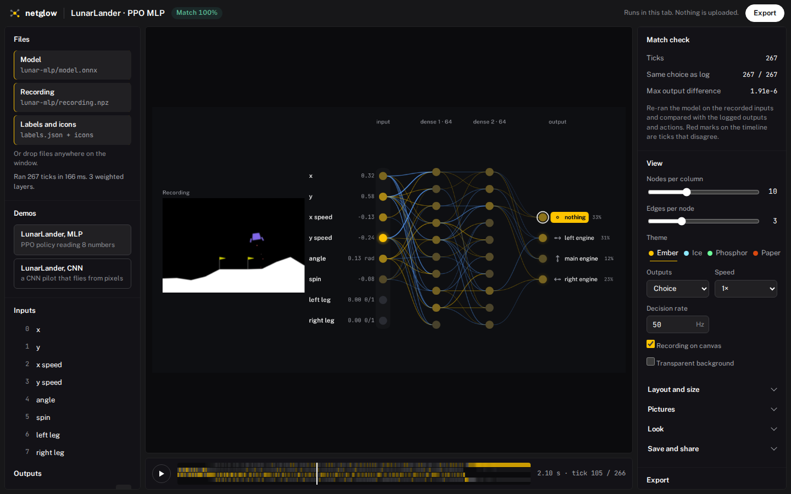
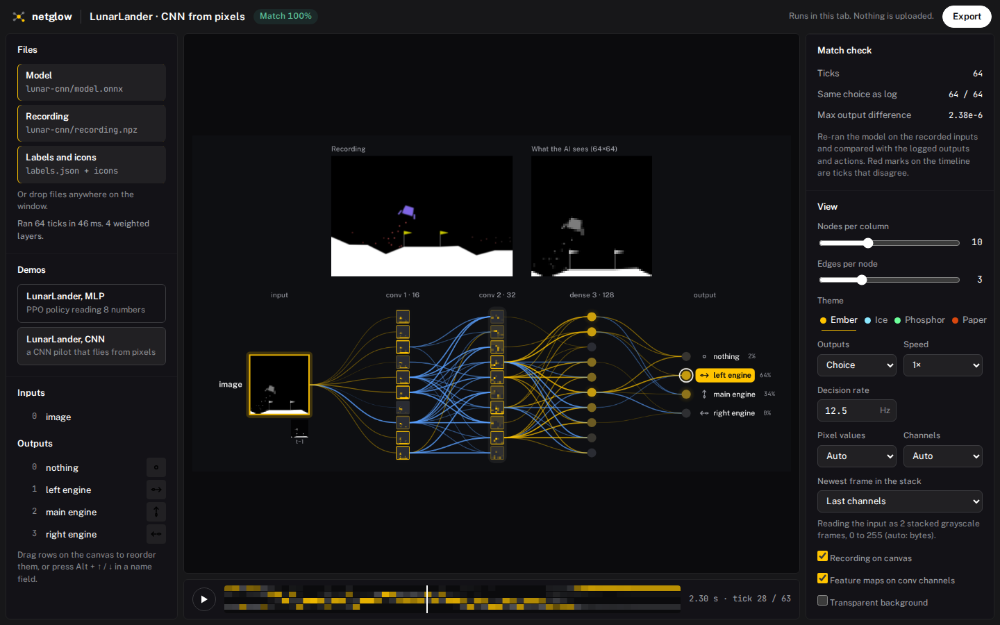

# netglow

Drop in a neural network and a recording of its inputs, and get an animated "glowing network" video of its
**real** activations, tick by tick. Everything runs in your browser tab: the model, the recording and the
video never leave your machine.



- **Inputs** on the left: label, live value; node colour = how fast that input is changing.
- **Hidden layers** as columns: brightness = activation, normalised per layer over the whole recording, so
  flicker is real change and not noise.
- **Outputs** on the right with your icons: glow = probability, the chosen (argmax) action ringed and lit.
- **Edges**: per node, the top-k strongest contributions this tick (warm = excites, cool = inhibits).
- **Match check**: the model is re-run on the recorded inputs and compared against the actions or outputs you
  logged, so you know the picture shows the network that actually flew the episode.
- **Export** GIF, MP4, WebM, or WebM with alpha to composite over your own footage.

### Image models



- The input column is one **image node**: the current tick's frame, nearest-neighbour upscaled so the
  pixels stay visible, its border lit by how much the frame changed since the last tick. Older frames of a
  stack sit under it (`t−1`, `t−2`, ...). Its edges into the first conv column are the per-channel
  contributions summed over the stack.
- **What the AI sees (W×H)**: a large view of the model's actual input, above the network or beside it
  (View → "What the AI sees"). With "Recording on canvas" on, the recording's own render sits next to it.
  Both are drawn on the canvas, so they are in every export, alpha included (the pictures are opaque, the
  rest stays transparent).
- **Feature maps on conv channels** (toggle): each shown conv channel is drawn as its live activation map
  (the real tensor, after the layer's nonlinearity / pooling), scaled per channel by its 1st to 99th
  percentile over the whole recording. The outline is lit by the channel's mean, as for a plain node.
- **Pixel values** are detected and undone for display: uint8 is shown as 0 to 255; floats in 0..1 or -1..1
  are mapped accordingly; anything else (mean/std normalised) is stretched per channel to its 1st..99th
  percentile. **Channels**: a channel count divisible by 3 is read as RGB frames, otherwise grayscale
  frames. **Newest frame**: last channels by default (first for stacks stored newest first). All three can
  be overridden in the View panel, which also says what was detected.

## 30-second quickstart

```bash
npm install
npm run dev          # http://localhost:5173
```

Click **LunarLander, MLP** under Demos. Press space to play, drag the input or output rows on the canvas to
reorder them, then **Export**.

To use your own policy:

```bash
cd python && uv venv && uv pip install -r requirements.txt
python export_recording.py --sb3 my_ppo.zip --env LunarLander-v3 --out my_run
```

and drop `my_run/model.onnx`, `my_run/recording.npz` and `my_run/labels.json` (plus icons) on the page.
For a plain torch module, see `python/export_recording.py` (`export_onnx`, `save_recording`).

`npm run build` produces a static `dist/` you can host anywhere (relative paths, no server code).

## Settings

Everything below applies live, is drawn into every export (GIF, MP4, WebM, WebM with alpha), and is kept
per model in this browser (localStorage). **Save and share** in the View panel resets to the defaults,
exports or imports the settings as JSON, and copies a link whose `#look=…` hash carries the look (not the
model or the recording) to anyone who opens it. Lengths are pixels at 720 p and scale with the export size.

| Group | Setting | Default | Range / options |
| --- | --- | --- | --- |
| View | Nodes per column | 10 | 3 to 24 |
| View | Edges per node (top-k) | 3 | 1 to 8 |
| View | Theme | Ember | Ember, Ice, Phosphor, Paper |
| View | Outputs | from the model | Choice (softmax, argmax ringed) or Values |
| View | Speed, decision rate | 1×, from the recording | 0.25× to 2×, any Hz |
| View | Recording on canvas, transparent background, feature maps | off, off, on | toggles |
| View (image models) | Pixel values, channels, newest frame | auto | 0–255 / 0–1 / −1–1 / stretch; gray / RGB; last / first |
| Layout and size | Node size | 1× | 0.4× to 2.5× |
| Layout and size | Thinnest / strongest edge | 1 / 2.6 px | 0.25 to 10 px (edge width grows with the contribution) |
| Layout and size | Label text / value text | 17 / 15 px | 9 to 36 / 8 to 32 px |
| Layout and size | Feature-map tiles, image node | 1×, 1× | 0.4× to 2.5× |
| Layout and size | Column spacing, row spacing | 1×, 1× | 0.4× to 1.4×, 0.4× to 1.8× |
| Layout and size | Canvas padding | 28 px | 0 to 96 px |
| Layout and size | Column titles | on | toggle |
| Pictures | What the AI sees: position, size | above, 1× | above, beside left / right, a corner, off; 0.3× to 2× |
| Pictures | Recording: position, size | next to the AI view, 1× | same positions; 0.3× to 2× |
| Look | Glow | 1× | 0 to 3× |
| Look | Decision pulse, strength | on, 1× | toggle, 0 to 5× |
| Look | Node shape | circle | circle, square |
| Look | Input values, output probabilities | on, on | toggles |
| Look | Exciting / inhibiting edge colour, background | the theme's | any colour; "Use the theme's colours" resets them |
| Export | Format, frame rate, size, from / to | GIF, 30 fps, 1280×720, whole recording | GIF, MP4, WebM, WebM with alpha; 24 to 60 fps; 5 sizes |

## Input format

### Model: `.onnx`

- One input tensor: `[N, features]` (MLP) or `[N, C, H, W]` (image, any dtype; in-graph `Cast` / `Div` are fine).
- Batch axis dynamic or fixed at 1. Weights embedded in the file (no external data).
- Chain-shaped: every node on the signal path has exactly one signal input. Supported weighted layers:
  `Gemm`, `MatMul` (constant weight on the right), `Conv` (group 1, explicit pads). Anything elementwise or
  reshaping between them is fine (`Relu`, `Tanh`, `BatchNormalization`, `MaxPool`, `Flatten`, ...).
- The first graph output is shown. A trailing `Softmax` is detected and the logits before it are used.

Graphs outside this shape (skip connections, concatenated multi-input towers, attention, recurrent cells) are
rejected with a message that names the node where the chain breaks.

### Recording: `.npz`, `.npy` or `.json`

| key | shape | required | meaning |
| --- | --- | --- | --- |
| `obs` | `(T, *input_shape)` | yes | the model input at every tick (a `.npy` file is taken as `obs`) |
| `actions` | `(T,)` int or `(T, A)` float | no | what was executed; used by the match check |
| `outputs` | `(T, n_out)` | no | raw model outputs logged at record time; match check |
| `t` | `(T,)` seconds | no | timestamps; sets the decision rate |
| `fps` | scalar | no | decision rate in Hz (wins over `t`) |
| `frames` | `(T, H, W, 3)` uint8 | no | a render of the episode, shown beside the network |
| `input_names`, `output_names` | unicode arrays | no | default labels |

JSON uses the same keys with nested lists: `{"obs": [[...], ...], "actions": [...], "fps": 50}`.
Plain arrays only: object / pickled arrays are refused.

### Labels and icons (optional): `labels.json` + `.svg` / `.png`

```json
{
  "title": "LunarLander · PPO MLP",
  "inputs": ["x", "y", "x speed", "y speed", "angle", "spin", "left leg", "right leg"],
  "outputs": ["nothing", "left engine", "main engine", "right engine"],
  "icons": ["icons/noop.svg", "icons/left.svg", "icons/main.svg", "icons/right.svg"],
  "output_mode": "categorical",
  "input_units": ["", "", "", "", "rad", "", "0/1", "0/1"]
}
```

Icons are tinted to the theme. Dropped icon files are matched to outputs by the basename in `icons`, by
index (`0.svg`, `out_0.png`) or by output label (`main_engine.svg`). Every label and icon can also be edited
in the left panel.

## What is exact and what is approximate

onnxruntime-web has no autograd, so netglow attributes with weights × activations, computed in JS from the
weights it reads out of the ONNX file and the intermediate tensors onnxruntime returns.

| Piece | Status |
| --- | --- |
| Activations, outputs, argmax | **exact**: the real forward pass in onnxruntime (graph optimisation off, intermediates added as graph outputs) |
| Dense ← dense edges | **exact** `W[j,i] · a[i]`: contribution of unit *i* to the pre-activation of unit *j* (bias excluded) |
| Dense ← conv edges (after `Flatten`) | **exact** per channel: `Σ_pixels W[j, c, p] · a[c, p]` |
| Conv ← conv edges | **exact for the channel mean**: contribution of input channel *c* to the spatial mean of output channel *d*'s pre-activation, `Σ_taps W[d,c,k] · mean(a[c] at the pixels tap k reads)` |
| Conv node brightness | **summary**: spatial mean of the channel; the feature-map toggle shows the full map |
| Image node edges | **exact**, summed: the per-channel conv contributions of every channel in the stack, added up |
| Through nonlinearities | **local**: contributions are into pre-activations; a ReLU that is off still draws its incoming edges. This is the linear part of the story, not a gradient through the whole network |
| Node selection | heuristic: units with the largest mean |contribution| into the shown units of the next column, from the outputs backwards |
| Node brightness curve | displayed as `v^0.7` of the normalised value (monotonic, lifts mid values) |
| Input node colour | `|x[t] − x[t−1]|` over that input's 95th percentile on the recording (images: mean over pixels per channel) |

## Limitations (v0)

- Chain-shaped graphs only (MLP, CNN encoder + MLP head). No residuals, multi-input, RNN / attention.
- One input tensor. Mixed image + vector observations need a single concatenated input for now.
- Image inputs must be channels-first `[N, C, H, W]`; a channels-last model (leading `Transpose`) is rejected.
- Grouped / depthwise convolutions are rejected; `Transpose` between conv and dense is warned about.
- The whole trace is held in memory: fine for small policies and recordings of a few thousand ticks.
- WebM / MP4 need WebCodecs (Chrome, Edge, recent Safari / Firefox). GIF works everywhere. WebM with alpha
  needs a VP9 encoder with alpha (Chrome / Edge).
- The decision pulse sweeps once per tick unless ticks come faster than about four video frames, then once
  per few ticks, so 50 Hz policies don't strobe at 30 fps.

## Layout of the code

| File | Owns |
| --- | --- |
| `src/onnx/proto.ts` | reading ONNX protobuf (nodes, weights, value infos) and appending graph outputs |
| `src/analyze.ts` | finding the chain of weighted layers and which tensors to fetch |
| `src/run.ts` | onnxruntime-web session, batched run over the recording |
| `src/compute.ts` | contributions, node selection, normalisation, match check |
| `src/render.ts` | drawing one frame on a canvas, themes, image node, feature maps, hit-testing for drag |
| `src/settings.ts` | the settings object: defaults, merge, localStorage, JSON and share-link hash |
| `src/image.ts` | turning an image input tensor back into pixels (range, gray / RGB, frame stack) |
| `src/export.ts` | GIF (gifenc) and WebCodecs video (mediabunny) |
| `src/io/npy.ts` | `.npy` / `.npz` (zip + DecompressionStream) / JSON readers |
| `python/` | demo training and `export_recording.py` |

## License

MIT

## Tests

With `npm run dev -- --port 5181` running (fixtures come from `test/make_fixtures.py`):

```bash
node test/smoke.mjs mlp        # also: cnn, rgbf, residual (expects a clear rejection), demo:lunar-mlp
node test/image.mjs            # image node, AI view, feature maps, pixel-range detection
node test/drag.mjs             # drag and keyboard reorder
node test/settings.mjs         # sizes and look change the render and the export; persist, reset, JSON, share link
node test/export.mjs mlp gif out.gif
```
